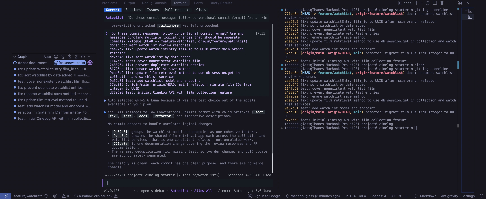

# PR Response Doc — CineLog Watchlist Feature

## AI Usage
I used AI tools to orient myself in the repository, inspect the original PR's
inline and conversation comments, compare `add_to_watchlist()` with
`add_to_collection()`, and verify all call sites before renaming. I also used
AI as a devil's advocate for Comments 4 and 5 by asking what counterargument a
careful reviewer might raise and what tradeoff was missing. That review
reinforced the privacy caveat for a public default and the lookup-vs-recency
tradeoff for date-added ordering; the final positions and wording are my
reasoning for CineLog.

## Comment 1 — Rename
**What I did:** Renamed `save_to_watchlist()` to `add_to_watchlist()` in
`services/watchlist_service.py`, following the existing `verb_to_noun`
convention used by `add_to_collection()`. I updated the import and call in
`routes/watchlist/watchlist.py`; a project-wide search found no other
references to the old name.
**How I verified:**
I reviewed all search results for both function names and ran the full test
suite after the rename.

## Comment 2 — Deduplication
**What I did:** I followed the existing `add_to_collection()` pattern in
`services/collection_service.py`. Its duplicate check calls
`CollectionEntry.query.filter_by(user_id=user_id, film_id=film_id).first()`;
when an entry is found, it raises `AlreadyInCollectionError` instead of
creating another row. I applied the same check to `WatchlistEntry` in
`add_to_watchlist()`, raising `AlreadyInWatchlistError` when a duplicate is
found.
**How I verified:**
I verified the check is performed after confirming the film exists and before
the new entry is added or committed, then ran the full test suite.

## Comment 3 — Missing test
**What I did:** Created `tests/test_watchlist.py` with the equivalent of
`test_add_to_collection_nonexistent_film_raises` from
`tests/test_collection.py`. It uses the same isolated in-memory app and
`sample_user` fixtures, supplies a nonexistent UUID, and asserts that
`FilmNotFoundError` is raised.
**How I verified:**
I ran `pytest tests/test_watchlist.py -v`, followed by `pytest tests/ -v`.

## Comment 4 — Default visibility
**My position:** Keep `public=True` as the default for new watchlist entries.
**Reasoning:**
Watchlists are a discovery and recommendation feature in CineLog: making a
list visible by default lets friends see what someone plans to watch and
creates useful social context without requiring an extra setup step. This
optimizes for the common behavior of sharing film interests while the user is
actively building a list.
**Tradeoff acknowledged:**
The alternative, `public=False`, would be safer for users who treat a
watchlist as private planning. A public default can expose preferences before
someone changes visibility, so the UI should make the setting clear and allow
users to make an entry private; this decision favors discoverability while
acknowledging that privacy needs a deliberate opt-out.

## Comment 5 — Sort order
**My position:** Use date-added order, newest first, and implement the
maintainer's preference in `get_watchlist()`.
**Reasoning:**
The watchlist is primarily a queue of films the user recently decided to
watch. Showing the most recent additions first makes the endpoint immediately
useful for returning to a current intention and matches the collection
service's existing newest-first behavior.
**Engagement with reviewer's point:**
I agree with the reviewer's reasoning that most users want to see recent
additions first. Alphabetical order is predictable for lookup, but it hides
recency and can make a newly added film difficult to find. I retained the
existing `date_added` metadata and changed the query to
`WatchlistEntry.date_added.desc()`; the tradeoff is that alphabetical
title-based browsing would now require a separate sort option if that becomes
a product need.

## Comment 6 — Rebase
**What conflicted:** Rebasing the original watchlist commit onto updated
`origin/main` produced a conflict in `models.py`: `WatchlistEntry.film_id`
was still `db.Integer` on the feature side while main had migrated `Film.id`
and collection foreign keys to UUID strings.
**How I resolved it:**
I kept the UUID-compatible `db.String(36)` foreign key from main and retained
the watchlist index. I also updated the watchlist endpoint documentation from
an integer film ID to a UUID representation, then committed that explicit
UUID update as `fix: update WatchlistEntry film_id to UUID after main branch
refactor`.
**How I verified no conflict remains:**
The rebase completed successfully after the conflict was staged and
continued. `git status` shows no unmerged paths, `git log --merges
origin/main..HEAD` is empty, the model diff uses UUID strings, and the full
test suite passes.

## PR Description
The watchlist feature lets a CineLog user add films for later and retrieve
their watchlist through the REST API. It validates that the film exists,
prevents duplicate user/film entries, preserves visibility metadata, and
returns the newest additions first. Film references use the UUID model from
`main`.

Design decisions:

- **Visibility default:** New watchlist entries remain public by default to
  support CineLog's social discovery use case. The tradeoff is that users
  who expect private planning must explicitly opt out, so the UI should make
  visibility clear and editable.
- **Sort order:** Watchlists are ordered by `date_added` descending (newest
  first), because recent viewing intentions are more useful than alphabetical
  lookup for the default view. Alphabetical sorting could be added as a
  separate option later.

Manual testing:

1. Start the CineLog Flask app using the repository's normal development
   command.
2. `POST /watchlist/<user_uuid>/add` with
   `{"film_id": "<existing_film_uuid>"}` and confirm a `201` response.
3. Repeat the same request and confirm the duplicate-entry error is returned
   without creating another row.
4. `POST` with a nonexistent UUID and confirm the film-not-found error.
5. `GET /watchlist/<user_uuid>` and confirm entries are newest first and
   include `date_added` and `public`.

Final history check (`git log --oneline origin/main..HEAD`; the terminal
screenshot is included below):



```text
771ce8e docs: document watchlist review responses
caa97d2 fix: update WatchlistEntry film_id to UUID after main branch refactor
dc7c646 fix: sort watchlist by date added
1147b52 test: cover nonexistent watchlist film
2488254 fix: prevent duplicate watchlist entries
61725ae fix: rename watchlist save method
9cae5c9 fix: update film retrieval method to use db.session.get in collection and watchlist services
9a52b81 feat: add watchlist model and endpoint
```